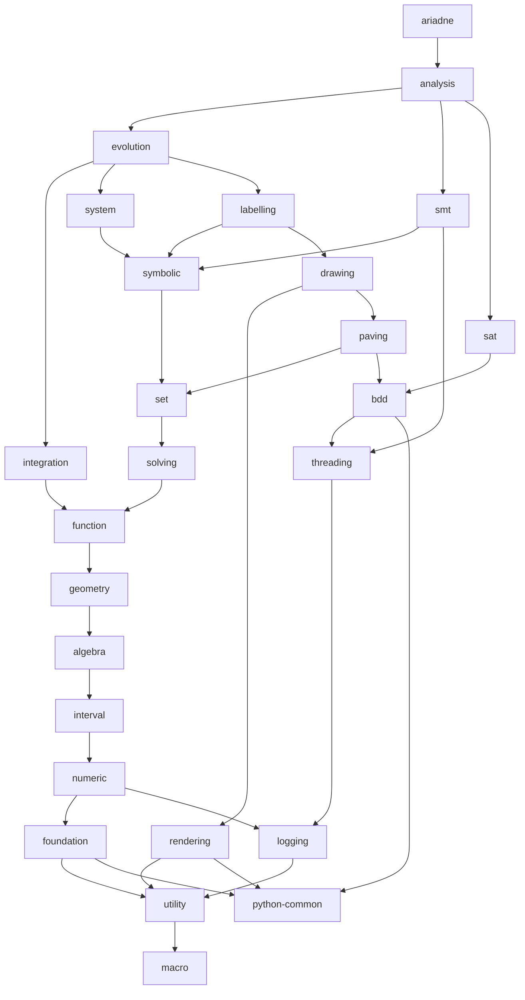

# Post-decoupling repository structure

This document describes the intended structure of Ariadne after the current decoupling effort.

## Repository hierarchy

The top-level repository is `ariadne`. Its dependency chain is organized as follows:

- `ariadne` uses `analysis`.
- `analysis` uses `evolution`, `smt`, and `sat`.
- `evolution` uses `integration`, `system`, and `labelling`.
- `integration` uses `function`.
- `system` uses `symbolic`, but does not use `labelling` directly.
- `smt` uses `symbolic` and `threading`.
- `sat` uses only `bdd`.
- `labelling` uses `symbolic` and `drawing`.
- `drawing` uses `rendering` and `paving`.
- `symbolic` uses `set`.
- `paving` uses `set` and `bdd`.
- `set` uses `solving`.
- `solving` uses `function`.
- `function` uses `geometry`.
- `geometry` uses only `algebra`.
- `rendering` uses `utility` and `python-common`.
- `bdd` uses `threading` and `python-common`.
- `threading` uses `logging`.
- `logging` uses `utility`.
- `utility` uses `macro`.
- `algebra` uses `interval`.
- `interval` uses `numeric`.
- `numeric` uses `foundation` and `logging`.
- `foundation` uses `utility` and `python-common`.

In addition, every repository uses `configuration`. This dependency is omitted from the graph below because it would otherwise appear from every repository node.

Dependencies are exposed transitively. In particular, `analysis` does not need a direct dependency on `labelling`: it receives `labelling` through `evolution`. Likewise, `system` and `smt` receive `set` transitively through `symbolic`, while `labelling` receives `set` both through `symbolic` and through `drawing -> paving`. `drawing` exposes `rendering` and `paving`, and `paving` exposes `bdd`. The `sat` repository depends exclusively on `bdd`, independently of `symbolic` and `paving`.

## Dependency graph



## Exposed dependencies and diamonds

Each repository exposes the repositories it uses to its consumers. Consequently, the dependency graph can contain diamonds: the same lower-level repository may be reachable from a consumer through more than one dependency path.

These diamonds are intentional. At CMake level, consistency is enforced by checking that whenever the same dependency appears multiple times along the dependency chains, every occurrence resolves to the same commit. A build must therefore not combine different commits of the same repository through different paths.

For example, `function` is reached from `evolution` directly through `integration`, and transitively through `symbolic -> set -> solving` along the `system` and `labelling` branches. The `labelling` branch also reaches `function` through `drawing -> paving -> set -> solving`. It is also reached from `analysis` through `smt -> symbolic -> set -> solving`. All paths must ultimately expose the same `function` commit. Likewise, `rendering` is exposed to `labelling` through `drawing`.

The `sat` branch also creates a diamond for `bdd`: `analysis` reaches `bdd` through `sat`, as well as through `evolution -> labelling -> drawing -> paving`. These paths must agree on the same `bdd` commit.

The direct `smt -> threading` dependency adds another diamond: `analysis` reaches `threading` through `smt`, through `sat -> bdd`, and through `evolution -> labelling -> drawing -> paving -> bdd`. All paths must resolve to the same `threading` commit.

Similarly, `analysis` reaches `labelling` transitively through `evolution`; no additional direct `analysis -> labelling` dependency is required.

## Minimal checkout strategy

The transitive dependency graph does not imply a recursive checkout of the whole submodule tree. The CMake dependency machinery checks out only what is strictly necessary for the repository being configured. When validating a dependency diamond, it descends into nested submodules only as far as needed to inspect and compare the referenced commits and verify that all paths resolve the same repository to the same commit.

Consequently, a recursive submodule checkout such as `git submodule update --init --recursive` is unnecessary for the normal build and consistency-checking workflow, and is inefficient because it materializes repositories that the current configuration does not need.

## Propagating changes upward

When a repository is modified and a repository above it must see those changes, the new dependency commit must be propagated upward along **every** path that reaches the consumer.

This is necessary because a repository can be exposed through several branches of the graph. Updating only one branch would make different paths resolve the same dependency to different commits, which the CMake consistency check is expected to reject.

As a concrete example, a change to `function` that must become visible to `ariadne` has to be propagated through all paths that reach it:

```text
function -> integration                                         -> evolution -> analysis -> ariadne
function -> solving -> set -> symbolic -> system                -> evolution -> analysis -> ariadne
function -> solving -> set -> symbolic -> labelling             -> evolution -> analysis -> ariadne
function -> solving -> set -> paving -> drawing -> labelling    -> evolution -> analysis -> ariadne
function -> solving -> set -> symbolic -> smt                                -> analysis -> ariadne
```

A change to `bdd` must similarly be propagated through both the direct `sat -> analysis` branch and the `paving -> drawing -> labelling -> evolution` branch, including all upstream routes through which `bdd` is exposed. A change to `threading` must additionally be propagated through `smt`, alongside the paths through `bdd`.

The special case is `configuration`: because every repository depends on it, making a new `configuration` commit visible at the top requires propagating that commit through the entire dependency graph, all the way to `ariadne`.
