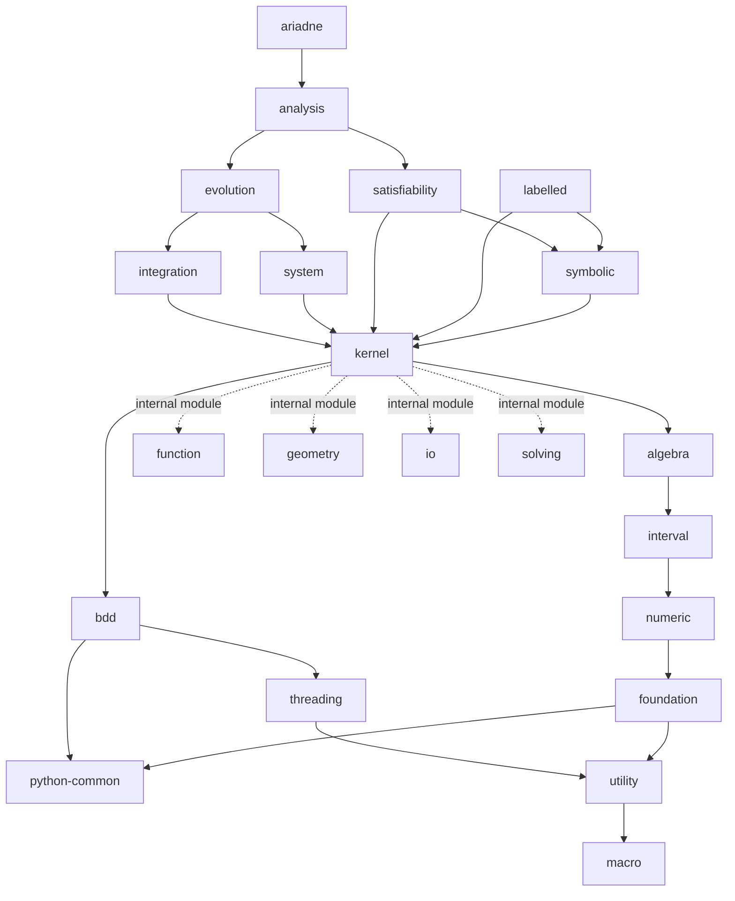

# Post-decoupling repository structure

This document describes the intended structure of Ariadne after the current decoupling effort.

## Repository hierarchy

The top-level repository is `ariadne`. Its dependency chain is organized as follows:

- `ariadne` uses `analysis`.
- `analysis` uses both `evolution` and `satisfiability`.
- `evolution` uses both `integration` and `system`.
- `integration` and `system` both use `kernel`.
- `satisfiability` uses both `kernel` and `symbolic`.
- `labelled` uses both `kernel` and `symbolic`.
- `symbolic` uses `kernel`.
- `kernel` remains an aggregate repository internally composed of the modules `function`, `geometry`, `io`, and `solving`. Until these modules can be decoupled further, they remain part of `kernel`.
- `kernel` uses `bdd` and `algebra`.
- `bdd` uses `threading` and `python-common`.
- `threading` uses `utility`.
- `utility` uses `macro`.
- `algebra` uses `interval`.
- `interval` uses `numeric`.
- `numeric` uses `foundation`.
- `foundation` uses `utility` and `python-common`.

In addition, every repository uses `configuration`. This dependency is omitted from the graph below because it would otherwise appear from every repository node.

## Dependency graph

In the graph, a solid arrow means "uses", while a dotted arrow marks an internal module contained in the `kernel` aggregate.



## Exposed dependencies and diamonds

Each repository exposes the repositories it uses to its consumers. Consequently, the dependency graph can contain diamonds: the same lower-level repository may be reachable from a consumer through more than one dependency path.

These diamonds are intentional. At CMake level, consistency is enforced by checking that whenever the same dependency appears multiple times along the dependency chains, every occurrence resolves to the same commit. A build must therefore not combine different commits of the same repository through different paths.

For example, `kernel` is reached from `evolution` through both `integration` and `system`. It is also reached from `satisfiability` both directly and through `symbolic`. All paths must ultimately expose the same `kernel` commit.

## Propagating changes upward

When a repository is modified and a repository above it must see those changes, the new dependency commit must be propagated upward along **every** path that reaches the consumer.

This is necessary because a repository can be exposed through several branches of the graph. Updating only one branch would make different paths resolve the same dependency to different commits, which the CMake consistency check is expected to reject.

As a concrete example, a change to `kernel` that must become visible to `ariadne` has to be propagated through all paths that reach it:

```text
kernel -> integration     -> evolution -> analysis -> ariadne
kernel -> system          -> evolution -> analysis -> ariadne
kernel -> satisfiability              -> analysis -> ariadne
kernel -> symbolic -> satisfiability  -> analysis -> ariadne
```

The special case is `configuration`: because every repository depends on it, making a new `configuration` commit visible at the top requires propagating that commit through the entire dependency graph, all the way to `ariadne`.
