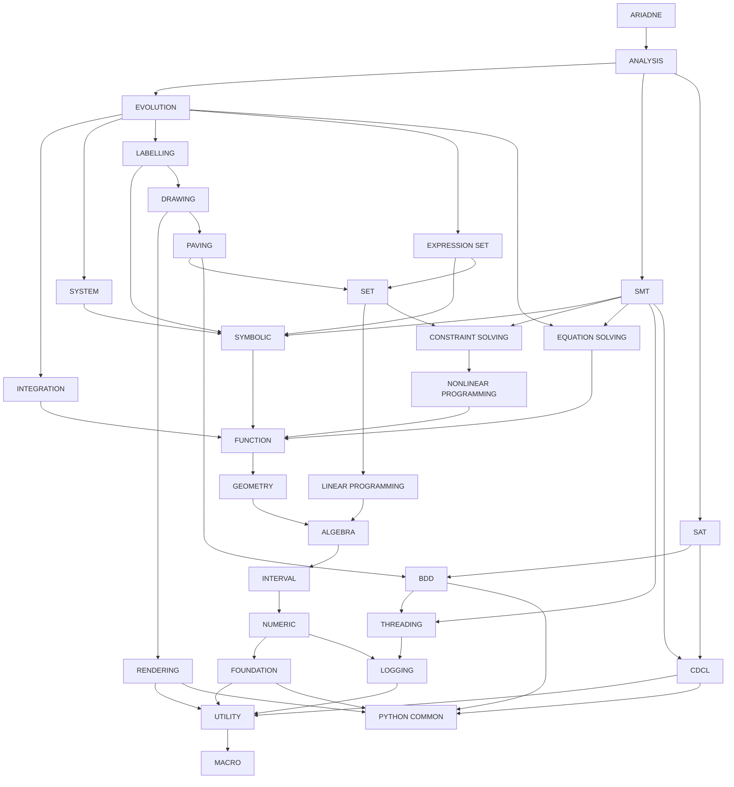

# Structure

Repository names in prose and dependency descriptions use their actual lowercase, hyphenated spelling; the graph uses uppercase, space-separated display labels.

The top-level repository is `ariadne`. The list below and the diagram show a *transitively reduced* dependency graph: edges implied by other dependency paths are omitted. The graph therefore preserves transitive reachability without necessarily listing every direct dependency declaration in the repositories:

- `ariadne` uses `analysis`.
- `analysis` uses `evolution`, `smt`, `sat`. See [commit constraints](#analysis-commit-constraints).
- `evolution` uses `integration`, `system`, `labelling`, `expression-set`, `equation-solving`. See [commit constraints](#evolution-commit-constraints).
- `integration` uses `function`.
- `system` uses `symbolic`.
- `labelling` uses `symbolic`, `drawing`. See [commit constraints](#labelling-commit-constraints).
- `drawing` uses `rendering`, `paving`. See [commit constraints](#drawing-commit-constraints).
- `expression-set` uses `symbolic`, `set`. See [commit constraints](#expression-set-commit-constraints).
- `paving` uses `set`, `bdd`. See [commit constraints](#paving-commit-constraints).
- `set` uses `linear-programming`, `constraint-solving`. See [commit constraints](#set-commit-constraints).
- `smt` uses `symbolic`, `constraint-solving`, `equation-solving`, `threading`, `cdcl`. See [commit constraints](#smt-commit-constraints).
- `sat` uses `bdd`, `cdcl`. See [commit constraints](#sat-commit-constraints).
- `symbolic` uses `function`.
- `constraint-solving` uses `nonlinear-programming`.
- `equation-solving` uses `function`.
- `nonlinear-programming` uses `function`.
- `linear-programming` uses `algebra`.
- `function` uses `geometry`.
- `geometry` uses `algebra`.
- `algebra` uses `interval`.
- `interval` uses `numeric`.
- `numeric` uses `foundation`, `logging`. See [commit constraints](#numeric-commit-constraints).
- `rendering` uses `utility`, `python-common`.
- `bdd` uses `threading`, `python-common`.
- `cdcl` uses `utility`, `python-common`.
- `threading` uses `logging`.
- `logging` uses `utility`.
- `foundation` uses `utility`, `python-common`.
- `utility` uses `macro`.

`python-common` and `macro` have no further dependencies in the graph. Each repository also uses `configuration`, which is omitted from the graph to avoid drawing an edge from every node.

All dependencies are exposed transitively. For example, `analysis` obtains `labelling` through `evolution`, so it does not need a direct `labelling` dependency. `expression-set` uses both `symbolic` and `set`; unlike the previous structure, `symbolic` uses `function` directly. `set` exposes `linear-programming` and `constraint-solving` directly in the reduced graph, and `nonlinear-programming` transitively through `constraint-solving`. The repositories `equation-solving` and `nonlinear-programming` use `function`, while `constraint-solving` uses only `nonlinear-programming`. Likewise, `smt` reaches `nonlinear-programming` through `constraint-solving`, so it needs no separate edge to `nonlinear-programming` in the reduced graph.

## Commit consistency verification

The dependency graph is a directed acyclic graph (DAG). Each repository must use the same commit for any dependency exposed by different direct submodules, even if those submodules reach it through different paths. The checks below are derived from the **transitively reduced graph above** and assume that each submodule has already validated its own dependencies. The checks below reflect the graph shown above.

### Verification rules

1. For each repository, consider every dependency reachable through two or more of its direct submodules. Only such shared dependencies can require a local cross-submodule commit comparison.
2. Compare commit identities (not merely repository names, branches, or version labels). A successful equality check on a dependency also fixes the commits of all its transitive dependencies, provided that the dependency's commit identifies an immutable, consistent submodule structure.
3. Perform the checks in dependency order: check an upstream/shared repository before using its equality to infer equality for repositories farther downstream. The local consistency of each submodule must also have been established before these inferences are used.
4. After checking a shared dependency, treat the direct submodules synchronized by that comparison as one equivalence group **for descendants of that shared dependency**. This does not assert that their unrelated dependencies match.
5. For a later shared dependency, compare just **one representative path from each still-distinct group** that reaches it. Choose the shortest path from any direct submodule in each group; if several paths are equally short, any one is sufficient.
6. Omit a downstream check if all direct submodules reaching that dependency already belong to one synchronized group. Do not omit a check that is still needed to connect another, previously unverified group.
7. `configuration`, which every repository uses but which is omitted from the graph, is excluded from the following graph-derived checks and must be handled separately.

All paths below start at a *direct submodule* of the repository named in the subsection. For each shared dependency, the listed paths must resolve to the same commit. The order of the subsections' checks is significant wherever a later check relies on an earlier equivalence.

**Example:** For `analysis`, checking `bdd` already synchronizes the `evolution` and `sat` branches for descendants of `bdd`. Therefore, the `threading` check only compares `sat -> bdd -> threading` with `smt -> threading`; a third `evolution` path is redundant.

### `analysis` commit constraints

- **`equation-solving`**:
  - `evolution -> equation-solving`
  - `smt -> equation-solving`
- **`cdcl`**:
  - `smt -> cdcl`
  - `sat -> cdcl`
- **`symbolic`**:
  - `evolution -> system -> symbolic`
  - `smt -> symbolic`
- **`bdd`**:
  - `evolution -> labelling -> drawing -> paving -> bdd`
  - `sat -> bdd`
- **`constraint-solving`**:
  - `evolution -> expression-set -> set -> constraint-solving`
  - `smt -> constraint-solving`
- **`threading`**:
  - `sat -> bdd -> threading`
  - `smt -> threading`

### `evolution` commit constraints

- **`symbolic`**:
  - `system -> symbolic`
  - `labelling -> symbolic`
  - `expression-set -> symbolic`
- **`set`**:
  - `labelling -> drawing -> paving -> set`
  - `expression-set -> set`
- **`function`**:
  - `integration -> function`
  - `system -> symbolic -> function`
  - `equation-solving -> function`

### `labelling` commit constraints

- **`function`**:
  - `symbolic -> function`
  - `drawing -> paving -> set -> constraint-solving -> nonlinear-programming -> function`

### `drawing` commit constraints

- **`python-common`**:
  - `rendering -> python-common`
  - `paving -> bdd -> python-common`
- **`utility`**:
  - `rendering -> utility`
  - `paving -> bdd -> threading -> logging -> utility`

### `expression-set` commit constraints

- **`function`**:
  - `symbolic -> function`
  - `set -> constraint-solving -> nonlinear-programming -> function`

### `paving` commit constraints

- **`logging`**:
  - `set -> linear-programming -> algebra -> interval -> numeric -> logging`
  - `bdd -> threading -> logging`
- **`python-common`**:
  - `set -> linear-programming -> algebra -> interval -> numeric -> foundation -> python-common`
  - `bdd -> python-common`

### `set` commit constraints

- **`algebra`**:
  - `linear-programming -> algebra`
  - `constraint-solving -> nonlinear-programming -> function -> geometry -> algebra`

### `smt` commit constraints

- **`function`**:
  - `symbolic -> function`
  - `constraint-solving -> nonlinear-programming -> function`
  - `equation-solving -> function`
- **`logging`**:
  - `symbolic -> function -> geometry -> algebra -> interval -> numeric -> logging`
  - `threading -> logging`
- **`python-common`**:
  - `symbolic -> function -> geometry -> algebra -> interval -> numeric -> foundation -> python-common`
  - `cdcl -> python-common`
- **`utility`**:
  - `threading -> logging -> utility`
  - `cdcl -> utility`

### `sat` commit constraints

- **`python-common`**:
  - `bdd -> python-common`
  - `cdcl -> python-common`
- **`utility`**:
  - `bdd -> threading -> logging -> utility`
  - `cdcl -> utility`

### `numeric` commit constraints

- **`utility`**:
  - `foundation -> utility`
  - `logging -> utility`

## Minimal checkout strategy

The transitive dependency graph does not imply a recursive checkout of the whole submodule tree. The CMake dependency machinery checks out only what is strictly necessary for the repository being configured. When validating a dependency diamond, it descends into nested submodules only as far as needed to inspect and compare the referenced commits and verify that all paths resolve the same repository to the same commit.

Consequently, a recursive submodule checkout such as `git submodule update --init --recursive` is unnecessary for the normal build and consistency-checking workflow, and is inefficient because it materializes repositories that the current configuration does not need.

## Propagating changes upward

When a repository is modified and a repository above it must see those changes, the new dependency commit must be propagated upward along **every** path that reaches the consumer.

This is necessary because a repository can be exposed through several branches of the graph. Updating only one branch would make different paths resolve the same dependency to different commits, which the CMake consistency check is expected to reject.

The special case is `configuration`: because every repository depends on it, making a new `configuration` commit visible at the top requires propagating that commit through the entire dependency graph, all the way to `ariadne`.
