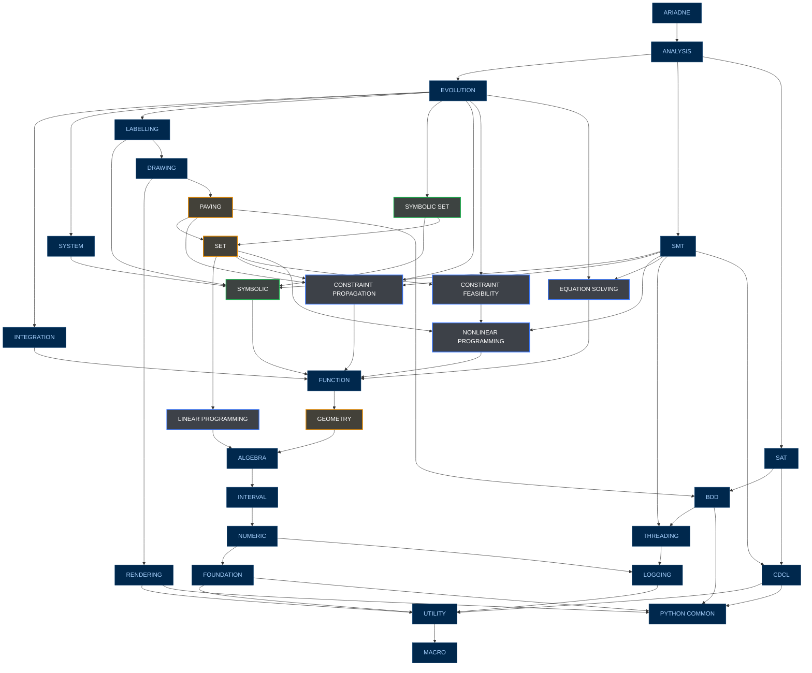

# Post-decoupling repository structure

This document describes the intended structure of Ariadne after the current decoupling effort. Repository names in prose and dependency descriptions use their actual lowercase, hyphenated spelling; the graph uses uppercase, space-separated display labels.

## Repository hierarchy

The top-level repository is `ariadne`. The direct repository dependencies shown in the diagram are:

- `ariadne` uses `analysis`.
- `analysis` uses `evolution`, `smt`, `sat`.
- `evolution` uses `integration`, `system`, `labelling`, `symbolic-set`, `constraint-propagation`, `constraint-feasibility`, `equation-solving`.
- `integration` uses `function`.
- `system` uses `symbolic`.
- `labelling` uses `symbolic`, `drawing`.
- `drawing` uses `rendering`, `paving`.
- `symbolic-set` uses `symbolic`, `set`.
- `paving` uses `set`, `constraint-propagation`, `bdd`.
- `set` uses `linear-programming`, `constraint-propagation`, `constraint-feasibility`, `nonlinear-programming`.
- `smt` uses `symbolic`, `constraint-propagation`, `nonlinear-programming`, `equation-solving`, `threading`, `cdcl`.
- `sat` uses `bdd`, `cdcl`.
- `symbolic` uses `function`.
- `constraint-propagation` uses `function`.
- `constraint-feasibility` uses `nonlinear-programming`.
- `equation-solving` uses `function`.
- `nonlinear-programming` uses `function`.
- `linear-programming` uses `algebra`.
- `function` uses `geometry`.
- `geometry` uses `algebra`.
- `algebra` uses `interval`.
- `interval` uses `numeric`.
- `numeric` uses `foundation`, `logging`.
- `rendering` uses `utility`, `python-common`.
- `bdd` uses `threading`, `python-common`.
- `cdcl` uses `utility`, `python-common`.
- `threading` uses `logging`.
- `logging` uses `utility`.
- `foundation` uses `utility`, `python-common`.
- `utility` uses `macro`.

`python-common` and `macro` have no further dependencies in the graph. Each repository also uses `configuration`, which is omitted from the graph to avoid drawing an edge from every node.

All dependencies are exposed transitively. For example, `analysis` obtains `labelling` through `evolution`, so it does not need a direct `labelling` dependency. `symbolic-set` uses both `symbolic` and `set`; unlike the previous structure, `symbolic` uses `function` directly. `set` exposes the dedicated `linear-programming`, `constraint-propagation`, `constraint-feasibility`, and `nonlinear-programming` repositories. The repositories `constraint-propagation`, `equation-solving`, and `nonlinear-programming` use `function`, while `constraint-feasibility` uses `nonlinear-programming`.

## Dependency graph



## Exposed dependencies and diamonds

Each repository exposes the repositories it uses to its consumers. Consequently, the dependency graph contains diamonds: the same lower-level repository may be reachable from a consumer through more than one dependency path.

These diamonds are intentional. At CMake level, consistency is enforced by checking that whenever the same dependency appears multiple times along dependency chains, every occurrence resolves to the same commit. A build must therefore not combine different commits of the same repository through different paths.

For example, `analysis` reaches `symbolic` through `evolution -> system`, `evolution -> labelling`, `evolution -> symbolic-set`, and `smt`. It reaches `set` through `evolution -> symbolic-set` and through `evolution -> labelling -> drawing -> paving`. The `set` dependencies introduce further diamonds for `constraint-propagation` and `constraint-feasibility`, since `evolution` also uses both directly; `constraint-propagation` is additionally used by `paving` and `smt`.

The `nonlinear-programming` repository is exposed through `set`, `constraint-feasibility`, and `smt`. Similarly, `equation-solving` is reached directly from `evolution` and through `smt`. The shared `function` repository is exposed through `integration`, `symbolic`, `constraint-propagation`, `nonlinear-programming`, and `equation-solving`. Every such path must agree on the dependency commit.

The `sat` branch also creates a diamond for `bdd`: `analysis` reaches `bdd` through `sat` and through `evolution -> labelling -> drawing -> paving`. Moreover, `analysis` reaches `cdcl` through both `smt` and `sat`, and reaches `threading` directly through `smt` and transitively through `bdd`. All paths must agree on the commit of each shared repository.

`algebra` is reached through both `function -> geometry` and `set -> linear-programming`; `python-common` is shared by `rendering`, `bdd`, `cdcl`, and `foundation`.

## Minimal checkout strategy

The transitive dependency graph does not imply a recursive checkout of the whole submodule tree. The CMake dependency machinery checks out only what is strictly necessary for the repository being configured. When validating a dependency diamond, it descends into nested submodules only as far as needed to inspect and compare the referenced commits and verify that all paths resolve the same repository to the same commit.

Consequently, a recursive submodule checkout such as `git submodule update --init --recursive` is unnecessary for the normal build and consistency-checking workflow, and is inefficient because it materializes repositories that the current configuration does not need.

## Propagating changes upward

When a repository is modified and a repository above it must see those changes, the new dependency commit must be propagated upward along **every** path that reaches the consumer.

This is necessary because a repository can be exposed through several branches of the graph. Updating only one branch would make different paths resolve the same dependency to different commits, which the CMake consistency check is expected to reject.

Representative (not exhaustive) paths for a change to `function` to reach `ariadne` include:

```text
function -> integration                                             -> evolution -> analysis -> ariadne
function -> symbolic -> system                                     -> evolution -> analysis -> ariadne
function -> symbolic -> labelling                                  -> evolution -> analysis -> ariadne
function -> symbolic -> symbolic-set                               -> evolution -> analysis -> ariadne
function -> constraint-propagation                                 -> evolution -> analysis -> ariadne
function -> nonlinear-programming -> constraint-feasibility        -> evolution -> analysis -> ariadne
function -> equation-solving                                      -> evolution -> analysis -> ariadne
function -> symbolic -> smt                                                     -> analysis -> ariadne
function -> nonlinear-programming -> smt                                        -> analysis -> ariadne
```

Additional paths pass through `paving`, `set`, and their consumers. The representative routes above do not replace the requirement to propagate along **all** paths in the dependency graph.

A change to `bdd` must be propagated through both `sat` and `paving -> drawing -> labelling -> evolution`, including all upstream consumers. A change to `threading` must additionally propagate through `smt`, alongside the routes through `bdd`. A change to `cdcl` must propagate through both `smt` and `sat` before reaching `analysis`. Similarly, changes to `constraint-propagation`, `constraint-feasibility`, `equation-solving`, or `nonlinear-programming` require updating every direct and transitive consumer shown in the graph.

The special case is `configuration`: because every repository depends on it, making a new `configuration` commit visible at the top requires propagating that commit through the entire dependency graph, all the way to `ariadne`.
