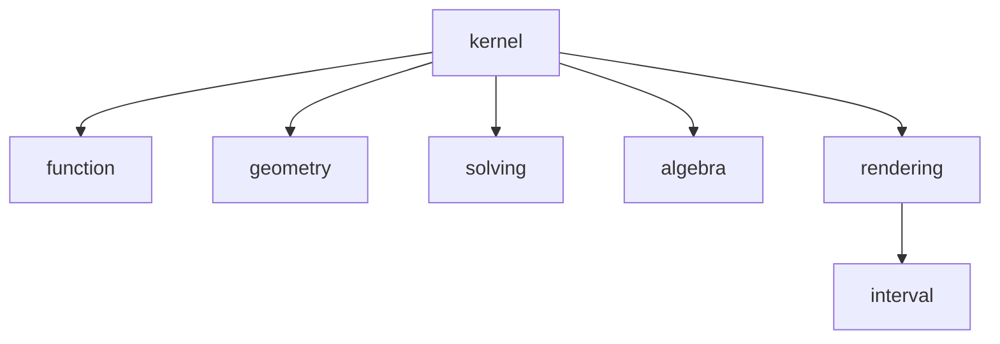

# Ariadne structure

## Target module structure

The decoupled Ariadne architecture separates the kernel from its external dependencies.

```text
ariadne
├── kernel
│   ├── function
│   ├── geometry
│   └── solving
├── algebra        (dependency)
└── rendering      (dependency)
    └── interval   (dependency of rendering)
```

The **kernel** contains exactly three modules:

- **function** — functions and their representations.
- **geometry** — geometric sets and operations.
- **solving** — algorithms for solving mathematical problems.

The kernel depends on **algebra** and **rendering**. **Rendering** in turn depends on **interval**; interval is therefore a transitive dependency through rendering, not a fourth kernel module.

## Dependency overview



This document describes the **target decoupled structure**, not necessarily the current build layout. In particular, the existing `source/` tree and CMake targets may still contain additional modules pending migration.
